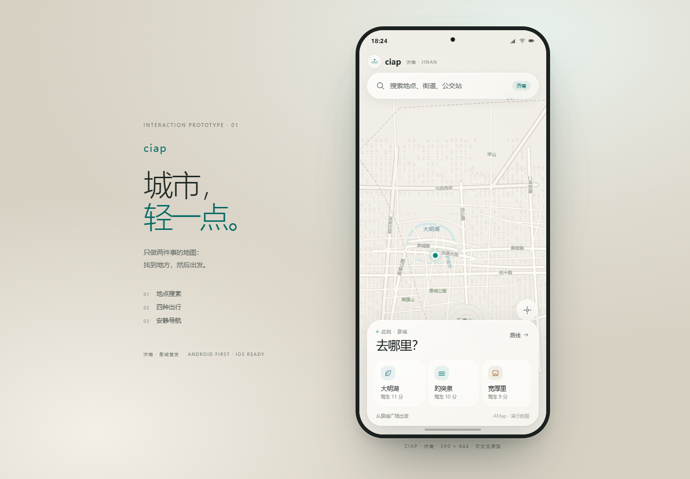
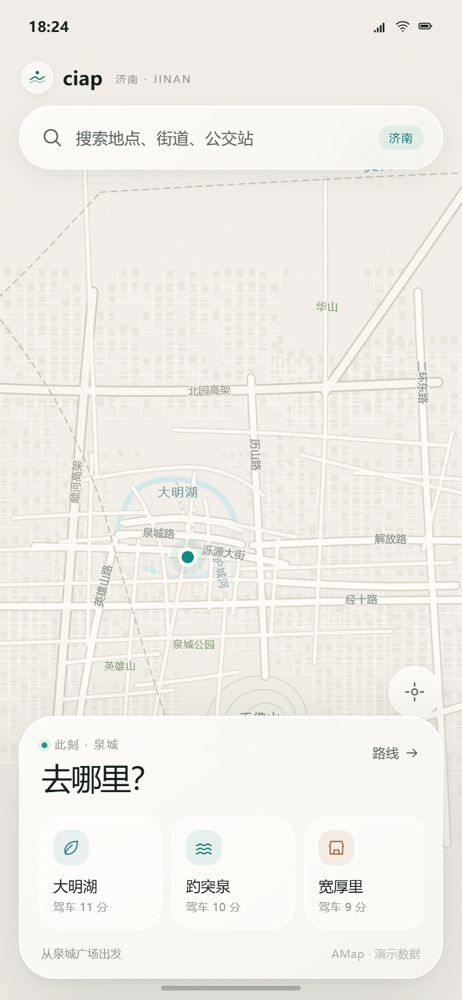
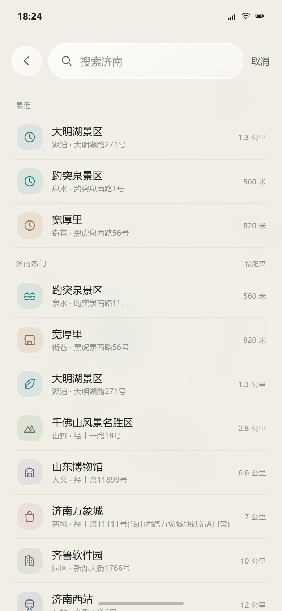
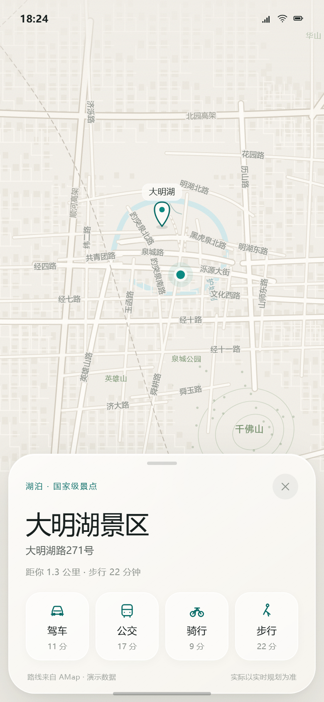
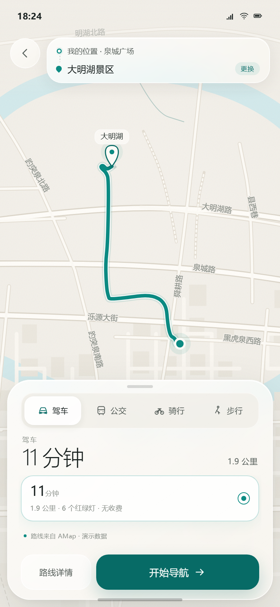
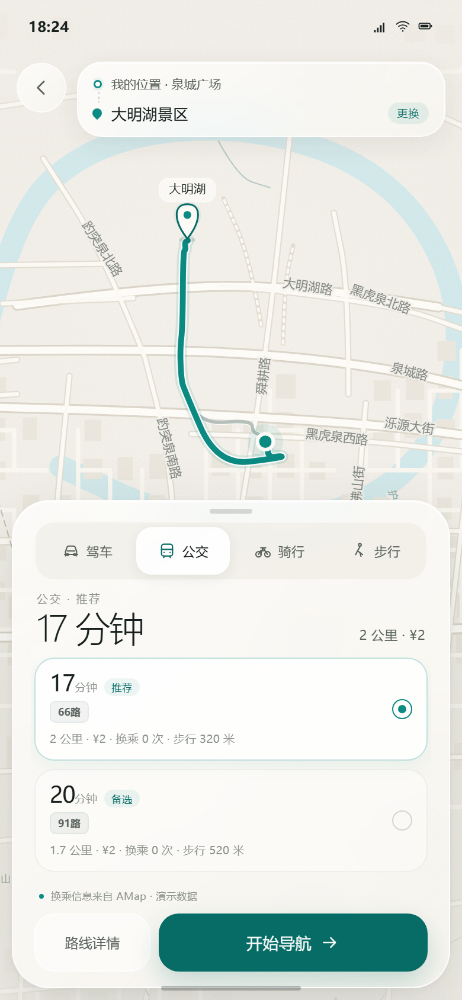
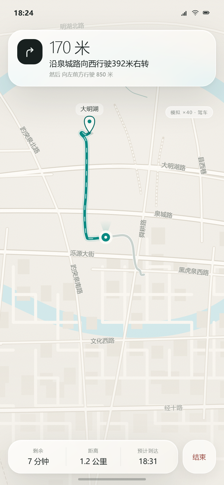

# ciap · 城市，轻一点。

> 济南单城交互原型 v0.1 — 只做两件事：找到地方，然后出发。  
> A new light map mobile app, based on the AMap API.  
> Android 先行，iOS 从第一天进入设计；生产实现为原生 UI + C17 共享内核，路线/地点数据以高德（AMap）为标准。



## 打开

- **最直接**：双击 `index.html`，用 Chrome / Edge / Safari 打开即可。桌面宽度下显示手机框；窄屏自动全屏。
- **本地服务**（可选，Node.js，无第三方依赖）：

```bash
node tools/serve.mjs
# http://127.0.0.1:4173
```

- 跳过启动动画：在地址后加 `?nointro=1`。

## 可以玩什么

1. **首页**：拖动地图、滚轮/双指缩放、点右下角定位回泉城广场。
2. **搜索**：点顶部搜索框，输入「大明」「趵突」「daminghu」等；空输入显示最近与济南热门。搜索只覆盖济南。
3. **地点**：点结果打开底部浮层，地图定位并出现目的地 pin；四种方式（驾车 / 公交 / 骑行 / 步行）各自有 AMap 实测时长。可下拉浮层关闭。
4. **路线**：点任一方式进入路线页；顶部起终点卡 + 地图路线；底部可切模式、点方案、展开「路线详情」。驾车单程只有一条推荐路线（数据说明见下），公交有两条。
5. **导航**：点「开始导航」进入模拟导航（40 倍速）：转向卡、剩余时间/距离/ETA、结束返回路线页；到达后出现「到了」卡片。也可直接拖到任意进度：
   `window.ciap.seekNav(0.5)`。

截图均为 390 × 844 @2x：

| 首页 | 搜索 | 地点 |
| --- | --- | --- |
|  |  |  |

| 驾车路线 | 公交路线 | 导航 |
| --- | --- | --- |
|  |  |  |

更多：`screenshots/00-splash.png`、`06-route-detail.png`、`08-airport.png`。

## 视觉方向：为什么是「通透」

- **瓷面底图**：暖灰纸面 `#F2EFE9`，水系青灰、公园灰绿、道路奶白；低对比、低噪音，信息靠留白分层。
- **泉青点睛**：济南是泉城，主色取泉水青 `#076B66` / `#0C8B83`。路线、主按钮、当前状态共用一种颜色，不堆第二强调色。
- **玻璃只做必要的地方**：搜索胶囊、地点浮层、路线底板、导航卡四处；面板悬浮但不遮住地图主体，阴影极轻、描边半透。
- **数字优先**：`11 分钟 / 1.9 公里` 大字号轻字重；地址、路名退到 9–12px 灰色层。一屏只有一个主行动。
- **安静动效**：只有状态变化才动；相机 900ms 缓动、面板 550ms 弹簧感；导航数字不跳闪。支持 `prefers-reduced-motion`。
- **品牌**：`ciap` 小写、宽字距；标志是一个落在水波上的点。「城市，轻一点。」是产品主张，也是每条交互的取舍标准。

## 数据与实现

- **地点与路线是真实高德数据**：10 个济南 POI（趵突泉、大明湖、千佛山、山东博物馆、济南西站、济南东站、遥墙机场、宽厚里、济南万象城、齐鲁软件园），来自 AMap Web Service `place/text`（`city=济南`、`citylimit=true`）。四种方式的路线来自 AMap driving v3 / walking v3 / bicycling v4 / transit integrated v3；起点为泉城广场（`117.022086,36.661373`）。
- 抓取日期 2026-11-09，离线固化在 `js/fixtures.js`（约 229KB）。**没有把 AMap key 写进仓库**；`.dsh/amap.key` 只在本地抓取时读取。
- 驾车 `strategy=4`（躲避拥堵）返回的线与推荐线完全相同，因此没有伪造第二条驾车方案；公交保留了两条真实方案。
- **底图是手绘示意底图**（Canvas），不是高德瓦片。它用于在无 key、无网络的情况下验证视觉方向；生产会换成高德自定义地图样式（同色系），路线/POI 仍由高德提供。济南东南西北的地标（黄河、大明湖、千佛山、泉城路、经十路、机场跑道等）按示意位置绘制。
- 实现无框架、无构建步骤：`index.html + styles.css + 4 个脚本`。所有 UI 图标为内联 SVG，没有图片请求，页面 JS 小。生产不会使用 WebView。
- 工具链只用 **Node.js**（抓数、自检、本地服务），没有 Python；生产共享领域内核用 **C17**（见下）。

## 生产架构（文档）

- [ARCHITECTURE.md](docs/ARCHITECTURE.md)：原生 UI（Kotlin/Compose + SwiftUI）+ C17 共享内核；地图/搜索/路线走 AMap 两端 SDK；单地图实例、浏览/导航互斥；BFF 归一化并保护 Web Service key；200MB PSS 预算表、熔断阶梯、启动顺序、性能预算、济南 adcode 配置、合规、测试与 P0–P4 路线图。
- [PRODUCT.md](docs/PRODUCT.md)：一页产品/UX brief，含「通透」原则、五屏清单、状态流转、文案、动效、无障碍与成功指标。

**关于 200MB**：这是生产验收线，不是这个网页原型的结论。网页原型只用于验证交互与视觉；架构文档给了 174MB 浏览态估算、180MB 导航估算、四级降级策略和 `dumpsys meminfo` / Instruments 的实测方法，需在 P1 真机校准。

## 验证

```bash
node tools/selftest.mjs   # 数据/几何/搜索/格式化/无 key 泄漏
```

自检结果：10 个 POI、50 条路线方案、4 种模式、全部折线可解析、起终点贴合、无 key。
浏览器端到端（DOM 真实点击）检查覆盖搜索打开 → 结果 → 地点 → 路线 → 详情 → 开始导航 → 结束 → 返回 → 快捷路线；0 runtime error；截图 0 console error。命令与截图脚本在 `.work/ciap-ui/`（不随产品交付）。

## 已知限制

- 这是 **Web 交互原型**，不是 APK；没有真实 GPS、语音播报、实时路况、偏航重算。导航为 40× 时间压缩模拟。
- 底图为示意，不是高德地图；POI/路线数据是 2026-11-09 的高德快照。
- 驾车只有一条 AMap 推荐路线；产品文档里的 2–3 条方案是生产目标，不是本原型现状。
- 200MB、启动速度、帧率等是生产目标，尚未在 Android/iOS 真机测量。
- 无账号、无图片、无广告、无社交——这些是刻意的。

## 下一步，等你拍板

1. **视觉再调**：更冷/更暖、玻璃更轻/更实、首页卡片是否再收、导航 HUD 信息密度。
2. **原生骨架**：Android Compose + AMap SDK + C17 core 的最小可运行壳（济南单城、搜索/四模式路线）。
3. **高德接入方式**：给我一个受限的 Web 服务 key 或 BFF 地址，把示意底图/离线 fixture 换成真实底图与线上路线。
4. **iOS 对等**：SwiftUI + MAMapView + 同一份 C core，先做地图/搜索/路线三屏。

---

文件结构：

```
ciap/
├─ index.html            交互入口（无构建）
├─ styles.css            设计 token / 玻璃 / 动效 / 五屏样式
├─ js/
│  ├─ fixtures.js        AMap 济南 POI + 四种方式路线（离线快照）
│  ├─ core.js            几何 / 搜索 / 格式化（生产对应 C core）
│  ├─ map.js             Canvas 济南示意底图、路线、相机、导航跟随
│  └─ app.js             五屏状态机与手势/事件
├─ docs/
│  ├─ ARCHITECTURE.md    生产架构 / 200MB 预算 / AMap / iOS / C17 / 合规
│  └─ PRODUCT.md         产品与 UX brief
├─ screenshots/          390×844 @2x 截图 + 展示图 + 启动图
└─ tools/
   ├─ serve.mjs          本地静态服务（Node）
   └─ selftest.mjs       自检（Node，无依赖）
```
